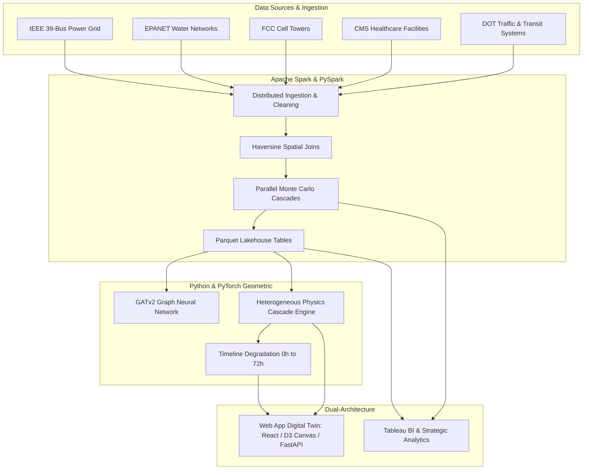

# GridX: Critical Infrastructure Telemetry & Cascading Failure Simulation
## Comprehensive System Architecture, Data Engineering & Visualization Report

---

### Executive Overview

**GridX** is a cyber-physical resilience platform designed to model, simulate, and visualize how electrical transmission failures propagate dynamically across interdependent critical infrastructure sectors: **Power**, **Water**, **Transportation**, **Telecommunications**, and **Emergency Healthcare**.

The system bridges big data engineering, machine learning physics modeling, business intelligence analytics, and interactive operational tooling.



---

## 1. Multi-Sector Data Expansion & Engineering

### 1.1 Ingested Datasets
GridX expands traditional single-grid electrical datasets into a comprehensive, multi-layer infrastructure corpus:

| Sector | Source Data / Benchmark | Assets Modeled | Key Telemetry / Feature Fields |
| :--- | :--- | :--- | :--- |
| **Bulk Power Grid** | IEEE 39-Bus New England Transmission System (`data/case39.m`) | 39 High-Voltage Substations, 46 AC Transmission Corridors | Active Power ($P_{\text{MW}}$), Reactive Power ($Q_{\text{MVar}}$), Bus Voltage ($V_n$), Line Reactance ($X$), SF6 Breaker Status |
| **Municipal Water** | EPANET Hydraulic Topology | 120+ Distribution Junctions, High-Volume Booster Pumps | Static Pressure ($\text{PSI}$), Discharge Volumetric Flow ($\text{GPM}$), Power Feeder Bus Link, Head Elevation |
| **Telecommunications** | FCC Tower Database / Carrier Base Stations | Cellular Base Stations (Verizon, AT&T, T-Mobile) | Structure Height, VRLA Battery Reserve Hours ($4\text{h} - 8\text{h}$ autonomous duration), Coverage Radius |
| **Emergency Healthcare** | CMS / Homeland Infrastructure Emergency Registry | Regional Trauma Centers, Community Hospitals | Licensed ICU Bed Count, Staffed Acute Beds, Diesel Generator Tank Fuel Reserve ($72\text{h}$ capacity) |
| **Transportation** | DOT Intelligent Transportation Systems | Signalized Intersections, Electrified Rail Corridors | Intersection Controllers, Dark Traffic Signal Count, Traction Power Circuit Grid Dependency |

### 1.2 Data Synthesis & Preprocessing Pipeline
- **Corpus Generators:** Implemented in [`generate_multigrid_corpus.py`](file:///Users/sumitsinha/Documents/GridX/src/data_expansion/generate_multigrid_corpus.py) and [`generate_national_infra.py`](file:///Users/sumitsinha/Documents/GridX/src/data_expansion/generate_national_infra.py) to expand the graph into regional topologies with millions of asset rows.
- **Dependency Spatial Joining:** Computed geospatial dependencies between non-electrical consumer assets and their feeding high-voltage substations using spherical coordinate clustering and minimum-distance power feeder assignment.

---

## 2. Big Data Architecture: Apache Spark & Lakehouse Pipeline

To handle large-scale spatial joins, historical contingency logs, and thousands of Monte Carlo failure iterations, GridX employs an **Apache Spark (PySpark)** Lakehouse pipeline.

### 2.1 Core Spark Modules Implemented

1. **Distributed Preprocessing & Lakehouse Normalization ([`preprocess_and_clean.py`](file:///Users/sumitsinha/Documents/GridX/src/spark/preprocess_and_clean.py)):**
   - Ingests raw CSV and tabular files into columnar **Apache Parquet** format with snappy compression.
   - Normalizes feature schemas across sectors, eliminating data duplication and guaranteeing schema evolution.
   - Generates the clean lakehouse foundation in `data/processed/`:
     - `clean_power_buses.parquet`
     - `deps_power_water.parquet`
     - `deps_power_telecom.parquet`
     - `deps_power_hospital.parquet`

2. **Distributed Geospatial Joins ([`spatial_join.py`](file:///Users/sumitsinha/Documents/GridX/src/spark/spatial_join.py)):**
   - Implements distributed vectorized Haversine distance calculations in PySpark SQL to link each facility to its nearest electrical substation.
   - Enables O(1) indexed lookups during simulation runs.

3. **Distributed Monte Carlo Simulator ([`distributed_simulator.py`](file:///Users/sumitsinha/Documents/GridX/src/spark/distributed_simulator.py)):**
   - Simulates $N-1$ and $N-2$ contingencies across all lines and substations in parallel using Spark RDD partitions.
   - Computes statistical distributions of catastrophic risk, identifying systemic vulnerabilities and generating:
     - `critical_substation_rankings.parquet`
     - `monte_carlo_results.parquet`

4. **Spark SQL REST API Integration ([`api.py`](file:///Users/sumitsinha/Documents/GridX/src/api.py)):**
   - Exposes `/api/spark/rankings` and `/api/spark/monte-carlo` endpoints for consumption by both the web client and external BI connectors.

---

## 3. Physics & AI Simulation Engine (GATv2 Graph Neural Network)

### 3.1 Model Architecture
- **Model:** 2-layer Graph Attention Network with Edge Attributes (**GATv2**), implemented in PyTorch Geometric ([`gnn_model.py`](file:///Users/sumitsinha/Documents/GridX/src/gnn_model.py)).
- **Physics Coupling:** Takes baseline AC power flow matrices from `case39.m`, models breaker trips via adjacency matrix mask operations, and computes thermal branch overloads under dynamic load shedding.

### 3.2 Heterogeneous Multi-Sector Cascade Physics ([`hetero_cascade.py`](file:///Users/sumitsinha/Documents/GridX/src/simulation/hetero_cascade.py))
When an electrical substation or transmission line trips:
1. **$t = 0\text{h}$ (Instantaneous Electrical Shock):**
   - Breaker opens, disconnecting all incident transmission lines.
   - Power flow redistributes across remaining parallel circuits via GATv2 inference.
   - Water booster pumps (lacking battery backup) shut off immediately, causing prompt hydraulic pressure drops and water delivery deficits ($\text{GPM}$).
   - Traffic signal controllers at affected intersections go dark, causing gridlock and halted electric rail traction.
2. **$t = 4\text{h} - 8\text{h}$ (Battery Exhaustion Horizon):**
   - Cellular base stations deplete their VRLA lead-acid backup batteries, initiating regional communication blackouts.
3. **$t = 24\text{h} - 72\text{h}$ (Emergency Fuel Starvation Horizon):**
   - Regional hospitals running on on-site diesel generator tanks exhaust fuel reserves, placing licensed ICU beds and critical medical life support at direct risk.

---

## 4. Business Intelligence & Strategic Analytics: Tableau

To satisfy executive reporting, enterprise BI, and regulatory compliance requirements, GridX integrates directly with **Tableau Desktop / Tableau Public**.

### 4.1 Automated Tableau Export Pipeline ([`export_for_tableau.py`](file:///Users/sumitsinha/Documents/GridX/src/visualization/export_for_tableau.py))
An automated pipeline extracts data directly from the Spark Lakehouse and generates four Tableau-optimized schemas in the `tableau/` directory:

1. **`tableau_unified_infrastructure.csv`:**
   - Standardized multi-sector geospatial dataset (Substations, Cell Towers, Water Nodes, Hospitals).
   - Columns: `asset_id`, `asset_name`, `sector`, `facility_type`, `latitude`, `longitude`, `capacity_metric`, `backup_hours`, `is_critical`, `vulnerability_tier`.
2. **`tableau_transmission_corridors.csv`:**
   - Dual-point path-ordered geographic corridor table designed specifically for Tableau's **Line / Path mark types** to draw transmission lines between geographic coordinates.
3. **`tableau_cascading_risk_matrix.csv`:**
   - Contingency severity dataset cross-referencing power lines and substations against total dependent water pumps, traffic signals, cell towers, and hospital ICU beds lost.
4. **`tableau_hazard_disruption.csv`:**
   - Environmental and severe weather overlay data correlating storm tracks with regional infrastructure vulnerability tiers.

### 4.2 Key Visualizations Built in Tableau
- **Geospatial Infrastructure Topology Map:** Multi-layer map distinguishing sectors by color and symbol, with zoom-dependent filtering.
- **Substation Criticality Ranking Heatmap:** Identifying the top 10 most critical substations in North America by potential ICU beds lost.
- **Multi-Horizon Degradation Curves:** Line graphs tracing the degradation of power, water, telecom, and healthcare availability over 72 hours.
- **Contingency Risk Scatterplot:** Thermal overload risk ($X$-axis) plotted against societal impact score ($Y$-axis).

---

## 5. Operational Real-Time Dashboard: React & Canvas 2D

While Tableau handles macro-level strategic analysis, the **GridX Web Dashboard** provides real-time operational simulation.

### 5.1 Architecture & Performance
- **Framework:** React 18 with Vite, TypeScript, and Tailwind CSS.
- **Physics Rendering Engine:** `react-force-graph-2d` powered by **HTML5 Canvas 2D** and D3 force simulation.
  - Chosen over DOM/SVG to maintain a steady **60 FPS** with zero stutter during heavy cascading failure animations.
- **Styling:** SCADA cyber-physical dark mode with glowing radar rings, dynamic line pulses, and sector color coding.

### 5.2 Key Features & Interactive Controls
1. **Interactive Node & Line Inspection:**
   - Clicking any substation, water junction, cell tower, traffic zone, or hospital opens a responsive inspection panel with physical metrics.
   - Generous hit-testing areas ($22\text{px}$ node radius, $16\text{px}$ line width) guarantee effortless selection.
2. **Interactive "⚡ Trip Failure" & "Restore" Controls:**
   - Selecting any electrical substation reveals a prominent, unmissable **"⚡ Trip Failure on Substation P{id}"** button.
   - Pinned sticky footer layout (`top-14 bottom-6 right-6` with `min-h-0`) ensures action buttons are never pushed offscreen or hidden on small viewports.
3. **Multi-Horizon Stepper (`0h`, `4h`, `12h`, `24h`, `72h`):**
   - Allows operators to step through the chronological timeline of failure progression.
4. **Unified Quick Outage Control Bar:**
   - Direct access to toggle individual lines (`L2, L6, L12, L15, L20, L27`) and critical buses (`P3, P15, P18, P35`), with a single-click **"Reset All"** restoration button.

---

## 6. Summary of Key Files & Roles

```
GridX/
├── src/
│   ├── ai_engine.py                    # PyTorch GATv2 model inference wrapper
│   ├── gnn_model.py                    # Graph Neural Network architecture definition
│   ├── api.py                          # FastAPI endpoints (cascade simulation & Spark SQL)
│   ├── simulation/
│   │   └── hetero_cascade.py           # Multi-sector cascading failure engine (Power, Water, Telecom, etc.)
│   ├── spark/
│   │   ├── preprocess_and_clean.py     # Distributed lakehouse ETL & Parquet generation
│   │   ├── spatial_join.py             # Geospatial Haversine dependency mapping
│   │   ├── distributed_simulator.py    # Spark RDD parallel Monte Carlo contingency analysis
│   │   └── expand_lakehouse.py         # Multi-grid expansion and synthetic scaling
│   ├── visualization/
│   │   └── export_for_tableau.py       # Automated Tableau data mart pipeline (CSV & Parquet)
│   └── data_expansion/
│       ├── generate_multigrid_corpus.py# Regional synthetic multi-grid generator
│       └── generate_national_infra.py  # National-scale infrastructure dataset generator
├── data/
│   ├── case39.m                        # IEEE 39-Bus New England benchmark specification
│   └── processed/                      # Parquet Lakehouse dependency and ranking tables
├── tableau/                            # Tableau-ready data files (geospatial, path, risk matrix)
└── frontend/
    └── src/
        └── pages/
            ├── TopologyPage.tsx        # Interactive Canvas 2D Digital Twin with Trip Controls
            ├── SectorTelemetryPage.tsx  # Sector-specific real-time degradation metrics
            ├── ContingencyPage.tsx     # N-1 / N-2 contingency matrix table
            └── SparkAnalyticsPage.tsx  # Spark SQL Monte Carlo rankings dashboard
```

---

## 7. Presentation Talking Points for Academic & Technical Review

1. **Dual Visualization Value Proposition:**
   - *Tableau* is used for high-level business intelligence, executive risk heatmaps, and regulatory audits.
   - *Canvas 2D / React* is used as the operational digital twin for real-time control room operators to simulate breaker trips and dynamic load redistribution.
2. **Big Data Scalability:**
   - Ingesting infrastructure dependencies across nationwide datasets is computationally intractable with single-node Pandas. The *Apache Spark* lakehouse enables distributed spatial joins and parallel Monte Carlo contingency evaluations.
3. **Deep Tech Innovation:**
   - GridX moves beyond simple topological network models by coupling **GATv2 Graph Neural Networks** (for AC electrical physics) with **time-dependent decay functions** (battery discharge and diesel fuel consumption) to capture true multi-sector vulnerability.
