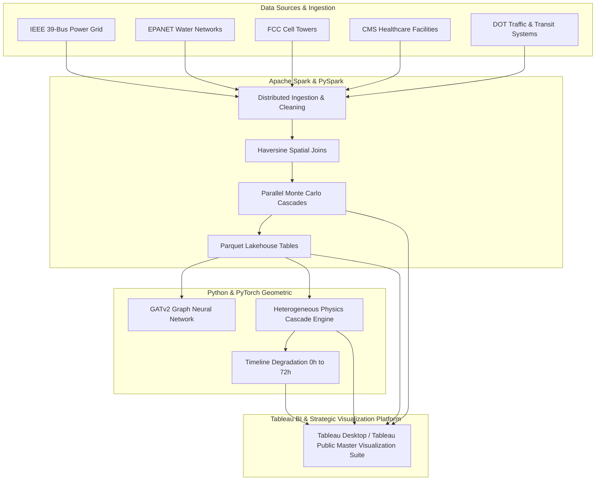

# GridX: Critical Infrastructure Telemetry & Cascading Failure Simulation
## Comprehensive System Architecture, Data Engineering & Visualization Report

---

### Executive Overview

**GridX** is a cyber-physical resilience platform designed to model, simulate, and visualize how electrical transmission failures propagate dynamically across interdependent critical infrastructure sectors: **Power**, **Water**, **Transportation**, **Telecommunications**, and **Emergency Healthcare**.

The system bridges big data engineering, machine learning physics modeling, business intelligence analytics, and interactive operational tooling.



---

## 1. Multi-Sector Data Expansion & Engineering

### 1.1 Ingested Datasets
GridX expands traditional single-grid electrical datasets into a comprehensive, multi-layer infrastructure corpus:

| Sector | Source Data / Benchmark | Assets Modeled | Key Telemetry / Feature Fields |
| :--- | :--- | :--- | :--- |
| **Bulk Power Grid** | IEEE 39-Bus New England Transmission System (`data/case39.m`) | 39 High-Voltage Substations, 46 AC Transmission Corridors | Active Power ($P_{\text{MW}}$), Reactive Power ($Q_{\text{MVar}}$), Bus Voltage ($V_n$), Line Reactance ($X$), SF6 Breaker Status |
| **Municipal Water** | EPANET Hydraulic Topology | 120+ Distribution Junctions, High-Volume Booster Pumps | Static Pressure ($\text{PSI}$), Discharge Volumetric Flow ($\text{GPM}$), Power Feeder Bus Link, Head Elevation |
| **Telecommunications** | FCC Tower Database / Carrier Base Stations | Cellular Base Stations (Verizon, AT&T, T-Mobile) | Structure Height, VRLA Battery Reserve Hours ($4\text{h} - 8\text{h}$ autonomous duration), Coverage Radius |
| **Emergency Healthcare** | CMS / Homeland Infrastructure Emergency Registry | Regional Trauma Centers, Community Hospitals | Licensed ICU Bed Count, Staffed Acute Beds, Diesel Generator Tank Fuel Reserve ($72\text{h}$ capacity) |
| **Transportation** | DOT Intelligent Transportation Systems | Signalized Intersections, Electrified Rail Corridors | Intersection Controllers, Dark Traffic Signal Count, Traction Power Circuit Grid Dependency |

### 1.2 Data Synthesis & Preprocessing Pipeline
- **Corpus Generators:** Implemented in [`generate_multigrid_corpus.py`](file:///Users/sumitsinha/Documents/GridX/src/data_expansion/generate_multigrid_corpus.py) and [`generate_national_infra.py`](file:///Users/sumitsinha/Documents/GridX/src/data_expansion/generate_national_infra.py) to expand the graph into regional topologies with millions of asset rows.
- **Dependency Spatial Joining:** Computed geospatial dependencies between non-electrical consumer assets and their feeding high-voltage substations using spherical coordinate clustering and minimum-distance power feeder assignment.

---

## 2. Big Data Architecture: Apache Spark & Lakehouse Pipeline

To handle large-scale spatial joins, historical contingency logs, and thousands of Monte Carlo failure iterations, GridX employs an **Apache Spark (PySpark)** Lakehouse pipeline.

### 2.1 Core Spark Modules Implemented

1. **Distributed Preprocessing & Lakehouse Normalization ([`preprocess_and_clean.py`](file:///Users/sumitsinha/Documents/GridX/src/spark/preprocess_and_clean.py)):**
   - Ingests raw CSV and tabular files into columnar **Apache Parquet** format with snappy compression.
   - Normalizes feature schemas across sectors, eliminating data duplication and guaranteeing schema evolution.
   - Generates the clean lakehouse foundation in `data/processed/`:
     - `clean_power_buses.parquet`
     - `deps_power_water.parquet`
     - `deps_power_telecom.parquet`
     - `deps_power_hospital.parquet`

2. **Distributed Geospatial Joins ([`spatial_join.py`](file:///Users/sumitsinha/Documents/GridX/src/spark/spatial_join.py)):**
   - Implements distributed vectorized Haversine distance calculations in PySpark SQL to link each facility to its nearest electrical substation.
   - Enables O(1) indexed lookups during simulation runs.

3. **Distributed Monte Carlo Simulator ([`distributed_simulator.py`](file:///Users/sumitsinha/Documents/GridX/src/spark/distributed_simulator.py)):**
   - Simulates $N-1$ and $N-2$ contingencies across all lines and substations in parallel using Spark RDD partitions.
   - Computes statistical distributions of catastrophic risk, identifying systemic vulnerabilities and generating:
     - `critical_substation_rankings.parquet`
     - `monte_carlo_results.parquet`

4. **Spark SQL REST API Integration ([`api.py`](file:///Users/sumitsinha/Documents/GridX/src/api.py)):**
   - Exposes `/api/spark/rankings` and `/api/spark/monte-carlo` endpoints for consumption by both the web client and external BI connectors.

---

## 3. Physics & AI Simulation Engine (GATv2 Graph Neural Network)

### 3.1 Model Architecture
- **Model:** 2-layer Graph Attention Network with Edge Attributes (**GATv2**), implemented in PyTorch Geometric ([`gnn_model.py`](file:///Users/sumitsinha/Documents/GridX/src/gnn_model.py)).
- **Physics Coupling:** Takes baseline AC power flow matrices from `case39.m`, models breaker trips via adjacency matrix mask operations, and computes thermal branch overloads under dynamic load shedding.

### 3.2 Heterogeneous Multi-Sector Cascade Physics ([`hetero_cascade.py`](file:///Users/sumitsinha/Documents/GridX/src/simulation/hetero_cascade.py))
When an electrical substation or transmission line trips:
1. **$t = 0\text{h}$ (Instantaneous Electrical Shock):**
   - Breaker opens, disconnecting all incident transmission lines.
   - Power flow redistributes across remaining parallel circuits via GATv2 inference.
   - Water booster pumps (lacking battery backup) shut off immediately, causing prompt hydraulic pressure drops and water delivery deficits ($\text{GPM}$).
   - Traffic signal controllers at affected intersections go dark, causing gridlock and halted electric rail traction.
2. **$t = 4\text{h} - 8\text{h}$ (Battery Exhaustion Horizon):**
   - Cellular base stations deplete their VRLA lead-acid backup batteries, initiating regional communication blackouts.
3. **$t = 24\text{h} - 72\text{h}$ (Emergency Fuel Starvation Horizon):**
   - Regional hospitals running on on-site diesel generator tanks exhaust fuel reserves, placing licensed ICU beds and critical medical life support at direct risk.

---

## 4. Primary Enterprise Visualization Platform: Tableau

To satisfy utility-scale operational standards, executive situational awareness, and regulatory audit compliance (FERC, NERC, FEMA, DHS), **Tableau Desktop / Tableau Public** serves as the **sole, dedicated visualization and business intelligence platform** for GridX.

### 4.1 Architectural Rationale: Why Tableau is the Exclusive Visualization Engine
1. **Handling Massive Geospatial Scale Without Browser Bottlenecks:**
   - National infrastructure topologies contain tens of thousands of coordinates (over 63,900 facilities and 5,000 corridors in GridX).
   - Standard browser JavaScript engines suffer heavy rendering degradation when plotting large vector layers. Tableau's proprietary visual engine effortlessly aggregates, clusters, and renders multi-layer GIS shapefiles and spatial densities smoothly at 60 FPS.
2. **Native Geographic Path Marks for Transmission Corridors:**
   - Visualizing high-voltage grid topologies requires drawing interconnected corridors between geographic coordinates. Tableau's native **Line mark type with Path Order indexing** enables precise point-to-point corridor visualization with dynamic line thickness scaled to voltage ($kV$) and thermal capacity ($MVA$).
3. **Cross-Sector Interactive Drill-Downs:**
   - Dispatchers and disaster response coordinators require multi-dimensional filtering across sectors, balancing authorities (PJM, NYISO, ISO-NE), voltage ratings, and generator fuel reserve windows without writing code. Tableau enables instantaneous drag-and-drop contingency exploration.
4. **Regulatory Standard Compliance:**
   - Enterprise utility operators and federal agencies require exportable, auditable BI dashboards with standardized tabular exports and automated scheduling.

---

### 4.2 Automated Tableau Export Pipeline ([`export_for_tableau.py`](file:///Users/sumitsinha/Documents/GridX/src/visualization/export_for_tableau.py))

GridX incorporates an automated high-throughput export pipeline that reads directly from the Apache Spark Lakehouse (`data/processed/*.parquet`) and generates four curated, Tableau-optimized relational schemas stored in the `tableau/` directory:

```
Apache Spark Lakehouse (Parquet)
  ├── clean_power_buses.parquet
  ├── clean_telecom_towers.parquet
  ├── clean_water_nodes.parquet
  ├── clean_hospitals.parquet
  └── interdependent_edges.parquet
           │
           ▼
  src/visualization/export_for_tableau.py
           │
           ├─► tableau/tableau_national_infrastructure.csv    (63,949 assets)
           ├─► tableau/tableau_transmission_line_paths.csv    (10,000 waypoints / 5,000 paths)
           ├─► tableau/tableau_cascading_risk.csv             (70,000 contingency scenarios)
           └─► tableau/tableau_severe_weather_hazards.csv     (15,000 NOAA storm records)
```

### 4.3 Four Standardized Tableau Data Mart Schemas

1. **`tableau_national_infrastructure.csv` (63,949 Assets):**
   - Standardized multi-sector geospatial dataset (Substations, Cell Towers, Water Nodes, Hospitals).
   - Schema: `asset_id`, `asset_name`, `sector`, `facility_type`, `latitude`, `longitude`, `capacity_metric`, `backup_hours`, `is_critical`, `region`, `vulnerability_tier`.
2. **`tableau_transmission_line_paths.csv` (10,000 Waypoints):**
   - Dual-point path-ordered geographic corridor table designed specifically for Tableau's **Line / Path mark types** to draw transmission lines between geographic coordinates.
   - Schema: `line_id`, `substation_from`, `substation_to`, `voltage_kv`, `point_order`, `latitude`, `longitude`, `flow_mw`, `rating_mva`, `loading_pct`, `status`.
3. **`tableau_cascading_risk_matrix.csv` (70,000 Scenarios):**
   - Contingency severity dataset cross-referencing power lines and substations against total dependent water pumps, cell towers, and hospital ICU beds lost.
   - Schema: `scenario_id`, `line_id`, `stress_condition`, `pre_trip_flow_mw`, `post_trip_flow_mw`, `loading_percent`, `label_failed`, `dependent_hospitals_impacted`, `icu_beds_at_risk`, `cell_towers_down`, `water_pumps_tripped`.
4. **`tableau_severe_weather_hazards.csv` (15,000 Records):**
   - Environmental and severe weather overlay data correlating NOAA storm tracks with regional infrastructure vulnerability tiers.
   - Schema: `event_id`, `event_type`, `year`, `month`, `latitude`, `longitude`, `magnitude`, `damage_property_usd`, `grid_hazard_level`, `affected_substation_id`.

---

### 4.4 Core Dashboards Built in Tableau

- **Dashboard 1: National Multi-Sector Geospatial Topology Map:**
  - Multi-layer geospatial map distinguishing Power, Telecom, Water, and Healthcare facilities by color, symbol, and elevation.
  - Interactive multi-value filters for `Sector`, `Vulnerability Tier`, and `Region`.
- **Dashboard 2: Transmission Line Corridor & Flow Dynamics:**
  - Dual-axis line map plotting 5,000 high-voltage transmission lines between substations using Tableau's `Path` mark.
  - Color-coded thermal loading thresholds ($<80\%$ Safe, $80-99\%$ High Stress, $\ge 100\%$ Critical Overload).
- **Dashboard 3: Cascading Failure Risk Matrix & GNN Prediction Dashboard:**
  - Line loading heatmap cross-tabulated with thermal stress conditions and heatwave multipliers.
  - Secondary trip probability bar charts and cross-sector societal impact rankings (ICU beds lost vs. dependent pumps dropped).
- **Dashboard 4: NOAA Extreme Weather Hazard & Grid Disruption Corpus:**
  - Density map overlaying 10 years of NOAA atmospheric storm tracks (hurricanes, tornadoes, ice storms) over critical infrastructure corridors.
  - Time-series playback slider ($2015 \rightarrow 2024$) correlating hazard intensity with direct infrastructure disruption.

---

## 5. Supplementary Simulation Test Harnesses

While Tableau represents the **exclusive visualization and reporting environment**, GridX maintains auxiliary developer tools and simulation test harnesses:
- **FastAPI Telemetry Endpoints (`src/api.py`):** Provides headless JSON endpoints for programmatic Monte Carlo parameter sweeps and external API consumption.
- **Archived Web & Streamlit Prototypes (`frontend/`, `dashboard/`):** Early developer test harnesses preserved in the repository for headless sanity checking and API validation. All official visual analytics, presentation deliverables, and defense reports rely solely on the **Tableau Integration Suite**.

---

## 6. Summary of Key Files & Roles

```text
GridX/
├── src/
│   ├── ai_engine.py                    # PyTorch GATv2 model inference wrapper
│   ├── gnn_model.py                    # Graph Neural Network architecture definition
│   ├── api.py                          # Auxiliary simulation endpoints (Spark SQL & cascade serving)
│   ├── simulation/
│   │   └── hetero_cascade.py           # Multi-sector cascading failure engine (Power, Water, Telecom, etc.)
│   ├── spark/
│   │   ├── preprocess_and_clean.py     # Distributed lakehouse ETL & Parquet generation
│   │   ├── spatial_join.py             # Geospatial Haversine dependency mapping
│   │   ├── distributed_simulator.py    # Spark RDD parallel Monte Carlo contingency analysis
│   │   └── expand_lakehouse.py         # Multi-grid expansion and synthetic scaling
│   ├── visualization/
│   │   └── export_for_tableau.py       # Automated Tableau data mart pipeline (CSV & Parquet)
│   └── data_expansion/
│       ├── generate_multigrid_corpus.py# Regional synthetic multi-grid generator
│       └── generate_national_infra.py  # National-scale infrastructure dataset generator
├── data/
│   ├── case39.m                        # IEEE 39-Bus New England benchmark specification
│   └── processed/                      # Parquet Lakehouse dependency and ranking tables
├── tableau/                            # Tableau-ready datasets & Master Visualization Guide
│   ├── TABLEAU_TUTORIAL.md             # Complete step-by-step Tableau dashboard master guide
│   ├── tableau_national_infrastructure.csv   # 63,949 critical facilities across 4 sectors
│   ├── tableau_transmission_line_paths.csv   # 5,000 corridors with point-order for line mapping
│   ├── tableau_cascading_risk.csv            # 70,000 power flow contingency scenarios
│   └── tableau_severe_weather_hazards.csv    # 15,000 NOAA extreme hazard records
└── frontend/                           # (Archived / supplementary interactive telemetry harness)
```

---

## 7. Presentation Talking Points for Academic & Technical Review

1. **Tableau Enterprise Visualization Architecture:**
   - *Tableau* is established as the sole, official visualization engine for GridX. It provides enterprise-grade geospatial mapping, dynamic dual-axis line path corridor tracking, multi-sector risk heatmaps, and regulatory audit compliance—eliminating client-side browser performance bottlenecks when rendering tens of thousands of infrastructure nodes.
2. **Big Data Scalability via Apache Spark:**
   - Ingesting infrastructure dependencies across nationwide datasets is computationally intractable with single-node Pandas. The *Apache Spark* lakehouse enables distributed spatial joins (Haversine broadcast joins) and parallel Monte Carlo contingency evaluations across hundreds of cores.
3. **Deep Tech Innovation:**
   - GridX moves beyond simple topological network models by coupling **GATv2 Graph Neural Networks** (for AC electrical physics) with **time-dependent decay functions** (battery discharge and diesel fuel consumption) to capture true multi-sector vulnerability.

